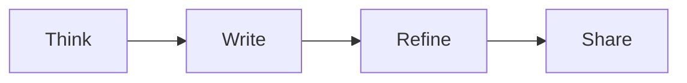

# A little room to think

Write in **Markdown**, keep your files, and follow an idea as far as it goes.

## A clear path

- [x] Start with a thought
- [ ] Give it shape
- [ ] Share it

## Make the details visible

| Tool | Purpose |
| --- | --- |
| Outline | Follow the structure |
| Linked notes | Keep the context |
| Diagram canvas | See the system |

An equation can be a sentence, too: $E = mc^2$.

$$
f(x) = \sum_{i=1}^{n} x_i^2
$$

<section>
  <h3>HTML belongs here</h3>
  
Use <strong>ordinary HTML</strong> when a document needs it. Unstyled content inherits Leaf's writing style.

</section>

## Keep the context

Link to [[Notes|a related note]], or embed one section:

![[Notes#One useful detail]]

Technical writing should stay readable.[^1]

[^1]: And its source should stay yours.
