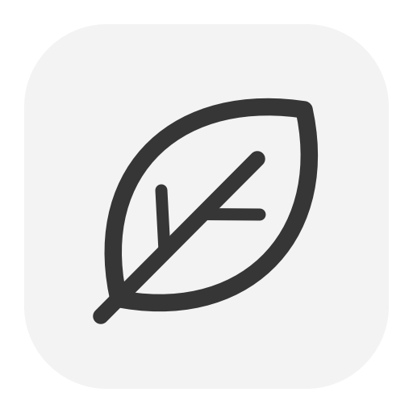
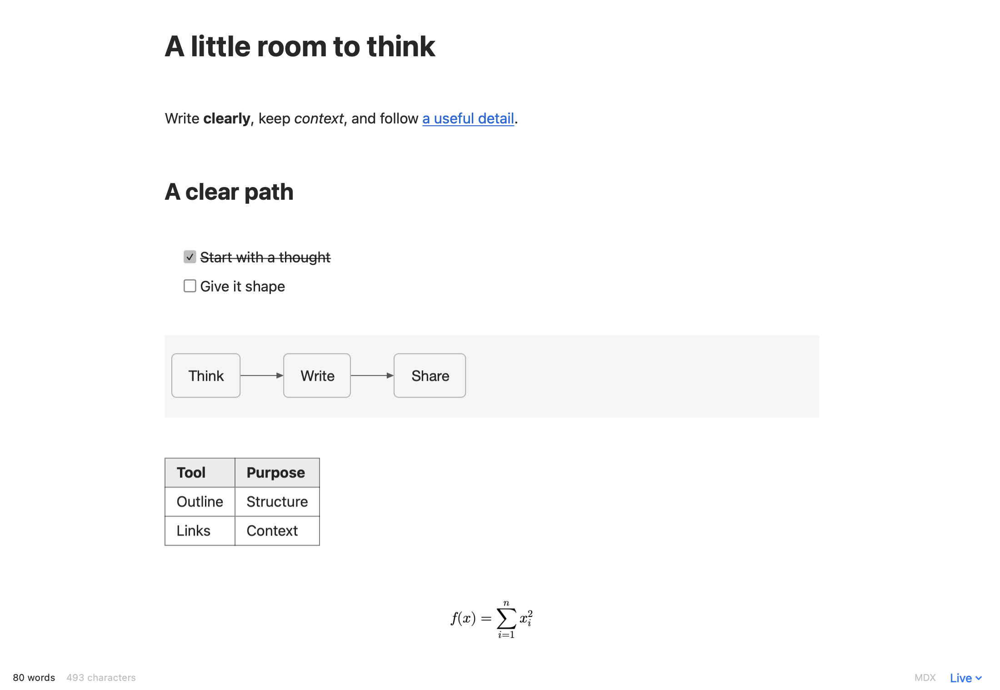

<p align="center">
  
</p>
<h1 align="center">Leaf</h1>
<p align="center">A native Markdown and MDX editor for macOS.</p>
<p align="center">
  
  
  
</p>

Leaf edits Markdown and MDX files in a native Mac window. Write with live formatting, edit the source or keep both views open. Open a folder to search your notes, follow links and keep related documents together.



## Write

Choose **Live**, **Source**, **Split** or **Reading** view. Leaf supports tables, task lists, code, math, static HTML and footnotes. Use multiple carets or rectangular selection for repeated edits, and preview regex replacements before applying them.

Press **⌘K** for commands or use these shortcuts:

| Key | Action |
| --- | --- |
| ⌘K | Open commands |
| ⌘P | Quick Open |
| ⇧⌘F | Find in folder |
| ⌥⌘S | Toggle source view |
| ⌥⌘D | Open the diagram canvas |
| ⌘D | Add the next occurrence |
| ⌥⌘click | Add a caret |
| ⌥drag | Make a rectangular selection |
| ⌘, | Open Settings |

Save a document before adding images. Pasted and dropped images go into a relative `assets` folder beside it.

## Connect your notes

Open a folder to browse files, switch document tabs and use Quick Open. Wiki links, backlinks and note or heading embeds keep related material within reach. Link-aware renames update references. Workspace changes keep a reversible journal in `.leaf/journal`.

## Diagrams and export

Open a Mermaid diagram on the native vector canvas to pan, zoom or fit it to the window. Export diagrams as SVG, PNG or PDF. Parsing and rendering work offline using the bundled [Pele](https://pele.run/) engine.

Export documents as HTML, paginated PDF, Word or EPUB. Choose document, report or book styles, with contents pages and page breaks. See [export details](Docs/exports.md) for format behaviour and limits.

## Settings

Press **⌘,** to change fonts, spacing, colours, shortcuts and caret motion. Settings apply globally or to the current folder, and can be imported or exported.

## Download

Download the latest [release](https://github.com/upsidedly/leaf/releases/latest), open the `.dmg`, and drag **Leaf** into **Applications**. These builds are for Apple silicon Macs. Quit an older Leaf before replacing it.

The app is locally signed and is not notarized. macOS may require first-launch approval in **System Settings → Privacy & Security**.

## Install from source

Use an Apple silicon Mac with macOS 14 or later, Swift 6 and a compatible macOS SDK.

```sh
git clone https://github.com/upsidedly/leaf.git
cd leaf
./Scripts/install.sh
open /Applications/Leaf.app
```

The script builds and signs the app locally and backs up an earlier installation. Quit Leaf before updating it. The build uses the installed macOS 26.5 SDK by default; set `LEAF_SDK` to use another compatible SDK.

## Privacy and compatibility

Leaf works offline and needs no account. Documents stay in your folders. Its bundled engines render Markdown, math and diagrams without downloading code, fonts or services. Node is needed only to rebuild the bundled JavaScript.

MDX opens without running document JavaScript. Static HTML and JSX content can render; imports, expressions and project components remain editable source. See [rendering details](Docs/rendering.md) for supported syntax and limits.

## Development

Build with `./Scripts/build.sh`. Run `./Scripts/check.sh` for core and offline engine checks. Use `LEAF_NATIVE_CHECKS=1 ./Scripts/check.sh` to open a test document and check native editing, recovery, workspace changes and exports. These checks use temporary fixtures.

Run `./Scripts/check-copy.sh` for focused clipboard checks: exact newlines and indentation, copy/paste round-trips, and formatted HTML, RTF and web-archive content. The checks preserve the existing clipboard.

See [verification notes](Docs/verification.md), the [plan](PLAN.md), [progress](PROGRESS.md) and [third-party notices](THIRD_PARTY_NOTICES.md) for implementation details and verification limits.
